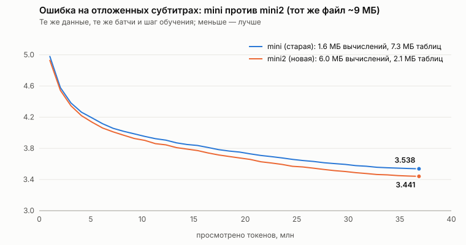

# mini2: тот же файл, но байты — на вычисления, а не на таблицы

**Итог коротко.** Файл модели почти весь был занят таблицами: из 8.9 МБ на вычисления («мозг») приходилось
1.6 МБ, ещё 2.4 МБ — память фактов, которая не работала, и 4.9 МБ — векторы слов в 16 битах. Теперь файл
перераспределён:

1. **Память фактов убрана** — без неё модель не хуже (ошибка 3.534 → 3.535).
2. **Векторы слов сжимаются до 4 бит прямо во время обучения.** Округлить готовую модель стоит заметных потерь,
   а если учиться со сжатием, потери почти исчезают (раздел 3). Эмбеддинг стал почти вчетверо компактнее на число (4.25 бита вместо 16).
3. **Освободившиеся ~6 МБ отданы вычислениям, в первую очередь вниманию.** Новая модель `mini2`: 6 слоёв
   внимания вместо 3, у каждой из 8 голов свои ключи (было 5 голов на 1 общий ключ), окно 256 токенов вместо
   128, ширина 512 вместо 320. Вычисляющих слоёв в файле — 6.0 МБ вместо 1.6, а файл даже меньше: 8.1 МБ.

| | `mini` (было) | **`mini2`** (стало) |
|---|---:|---:|
| Файл | 8.9 МБ | **8.1 МБ** |
| из них вычисления / таблицы | 1.6 / 7.3 МБ | **6.0 / 2.1 МБ** |
| Предобучение: перплексия на отложенных субтитрах (те же 37 млн токенов) | 34.3 | **31.0** |
| Дословно переписывает текст, сказанный 192 токена назад | +0.1 пункта | **+5.2 пункта** |
| Собеседник: ошибка на отложенных диалогах | 1.346 | **1.190** |
| **Собеседник: верных ответов на 1 431 задаче** | 44.4% | **55.3%** |
| Скорость ответа в браузере (этот ПК) | ~80 токенов/с | ~28 токенов/с |

**Прирост дала именно архитектура, а не рецепт обучения:** старая `mini`, обученная тем же рецептом на тех же
данных (контроль), решает 43.0% задач — как прежний собеседник; `mini2` — на 12 пунктов больше. Сильнее всего
новая архитектура помогла там, где нужно удержать слово из разговора или справки (контроль → `mini2`): ответ по
справке 63% → 80%, имя 42% → 60%, два факта о себе 35% → 55%, цепочки сравнений 31% → 38% («Маша > Петя >
Коля» больше не превращается в «Петя > Петя > Петя»), а ещё задачи на счёт 30% → 83% и столицы 7% → 87%.
Просел один навык — «Напомни мой возраст» (55% → 0%), но так же и у контроля: это цена рецепта, а не
архитектуры (раздел 6). Редкие длинные имена («Всеволод») модель всё ещё искажает.

Чтобы втрое больший объём вычислений поместился в обычный процессор, обучение переведено на bf16 (блок AMX у
Intel Xeon): в 2.5 раза быстрее при той же точности. Предобучение `mini2` заняло 4.6 часа на 4 ядрах —
столько же, сколько у `mini` раньше, пост-тренинг — 2.1 часа. Мобильный чат по умолчанию качает `mini2`.

## 1. Куда уходили 9 МБ

«Рентген» ([TRAINING_REASONING_RU.md](TRAINING_REASONING_RU.md), раздел 1) показал, что файл модели `mini`
почти весь занят таблицами, а не тем, что считает ответ:

| Часть `slr_net_chat_ru_mini.npz` | Места в файле | Работает? |
|---|---:|---|
| Эмбеддинг слов (float16; он же выходной слой) | 4.9 МБ | да, но 16 бит на число — с большим запасом |
| Память фактов (4 096 ячеек product-key memory) | 2.4 МБ | **нет**: без неё ошибка та же (0.4945 → 0.4946) |
| Троичные слои {−1, 0, +1}: Mamba-2, внимание, ядро мышления | **1.6 МБ** | да — это и есть «мозг» |
| Токенизатор и прочее | 0.4 МБ | да |

При этом главная ошибка модели — **не умеет дословно переписать слово из разговора**: «Маша > Петя > Коля»
превращается в «Петя > Петя > Петя», выдуманное слово — в другое. Переписывать текст умеет внимание, а
не слои Mamba (Jelassi и др., 2024, «Repeat After Me»). В `mini` внимания мало: 3 слоя из 11, у каждого
5 голов делят **один** ключ на всех, и смотрят они только на последние 128 токенов.

Отсюда план, который здесь и выполнен:
1. **Убрать память фактов** — она не работает (2.4 МБ).
2. **Сжимать эмбеддинг до 4 бит прямо во время обучения** — так же, как троичные слои с самого начала учатся
   жить со своими {−1, 0, +1}. Округлять готовую модель нельзя: это стоило 6 пунктов на задачах
   ([TRAINING_REASONING_RU.md](TRAINING_REASONING_RU.md), раздел 5.4).
3. **Отдать освободившиеся ~6 МБ вычислениям, в первую очередь вниманию.**

## 2. Что изменено

| | `mini` (было) | `mini2` (стало) |
|---|---|---|
| Ширина модели | 320 | 512 |
| Слоёв внимания | 3 (из 11) | **6** (из 14) |
| Голов внимания / своих ключей | 5 / **1 общий** | 8 / **8** — у каждой головы свои ключи |
| Окно внимания | 128 токенов | **256** — весь контекст обучения |
| Слоёв Mamba-2 | 6 + 2 в ядре мышления | 6 + 2 в ядре мышления |
| Память фактов | 4 096 ячеек | **нет** |
| Эмбеддинг | float16 (16 бит на число) | **4 бита** + масштаб float16 на каждые 64 числа (4.25 бита) |
| Параметров | 12.3 млн | 36.1 млн |
| из них троичных (вычисления) | 8.3 млн | **31.7 млн** |
| **Вычисляющие слои в файле** | **1.6 МБ** | **6.0 МБ** |
| Таблицы (эмбеддинг + память) | 7.3 МБ | 2.1 МБ |
| Файл целиком | 8.9 МБ | **8.1–8.2 МБ** (собеседник / продолжатель) |

Новое в коде (всё включается настройками, старые модели работают как раньше):
- `memory_keys=0` — модель без памяти фактов (`slr_net_engine.py`, браузер, `weights_xray.py`).
- `embed_bits=4`, `embed_group=64` — эмбеддинг, сжатый во время обучения. В каждом проходе таблица
  округляется: строка делится на группы по 64 числа, у группы свой масштаб s = max|w| / 7, число → одно из
  15 значений {−7s … 7s}. Градиент проходит к исходным «мастер-весам» как есть (STE — тот же приём, что у
  троичных слоёв BitNet). Масштаб тоже сразу округляется до float16 — ровно так он лежит в файле, поэтому
  модель при обучении видит те же самые числа, что и после упаковки. В файле — два числа в байте плюс
  масштабы; после загрузки эмбеддинг совпадает с обученным бит в бит (это проверяет тест).
- Пресет `mini2` и формула размера по частям файла (`calculate_hardware_footprint`).
- `train_lm.py train --init модель.npz --set memory_keys=0 embed_bits=4` — дообучать готовую модель в новых
  настройках; `train_lm.py export --set …` — сжать готовую модель без дообучения;
  `train_lm.py copytest` — проверка дословного копирования (раздел 5.1); `train_chat.py sft --set …`.
- `--dtype bf16` на процессоре (раздел 4).

## 3. Сжатие эмбеддинга во время обучения: проверка

Опыт на готовой модели-продолжателе `slr_net_subtitles_ru_mini.npz`: что будет, если выбросить память и
сжать эмбеддинг до 4 бит **после** обучения, и что — если ещё немного **поучить со сжатием**. Чтобы отделить
пользу самих лишних шагов, контроль учился столько же, но без сжатия. Ошибка — на 819 200 отложенных токенах
субтитров (`train_lm.py eval`, 200 батчей; меньше — лучше).

| Вариант | Ошибка | Перплексия | Файл |
|---|---:|---:|---:|
| Модель из репозитория | 3.534 | 34.3 | 8.9 МБ |
| … без памяти фактов | 3.535 | 34.3 | 6.6 МБ |
| … без памяти, эмбеддинг округлён до 4 бит **после** обучения | 3.560 | 35.2 | 3.0 МБ |
| … без памяти, ещё 400 шагов **без** сжатия (контроль) | 3.521 | 33.8 | 6.6 МБ |
| … без памяти, ещё 400 шагов **со сжатием** до 4 бит | 3.537 | 34.3 | 3.0 МБ |

1. **Память фактов не нужна и базовой модели**: без неё ошибка 3.534 → 3.535.
2. **Округление после обучения стоит** +0.026, а 400 шагов со сжатием (1.6 млн токенов, 6 минут) отыгрывают
   больше половины: от контроля отстаёт на 0.015 вместо 0.039. Модель, которая со сжатием учится **с нуля**
   (как `mini2`), подстраивается к нему с первого шага.
3. Та же модель в 3 раза меньше (3.0 МБ) почти без потерь — на случай, если нужен совсем лёгкий файл.

Журнал и цифры — [`training/mini2/qat_embedding.log`](training/mini2/qat_embedding.log),
[`qat_embedding_eval.json`](training/mini2/qat_embedding_eval.json).

## 4. Обучение на процессоре в 2.5 раза быстрее: bf16

`mini2` считает втрое больше, чем `mini`. В float32 на 4 ядрах она учится 912 токенов/с — предобучение
заняло бы 11 часов. Но у процессора этой машины (Intel Xeon 4-го поколения) есть блок AMX, который умножает
матрицы в bf16 в разы быстрее. `--dtype bf16` включает bf16 только для умножений; мастер-веса, квантование,
скан Mamba, ошибка и проверка остаются во float32.

| Скорость обучения, токенов/с (16 × 256 токенов на шаг, 4 ядра) | float32 | bf16 |
|---|---:|---:|
| `mini` | 2 927 | 4 871 |
| `mini2` | 912 | **2 343** |

Чтобы bf16 не исказил сравнение, `mini` обучена заново в bf16 с теми же зерном, данными и батчами, что и в
[TRAINING_RU_SUBTITLES.md](TRAINING_RU_SUBTITLES.md), — первые 500 шагов:

| Шаг | Ошибка на обучающем батче: float32 (тогда) / bf16 (сейчас) | Ошибка на отложенных: float32 / bf16 |
|---:|---:|---:|
| 0 | 9.0767 / 9.0772 | — |
| 20 | 7.5964 / 7.5969 | — |
| 250 | — | 4.9795 / 4.9763 |
| 500 | — | 4.5786 / 4.5763 |

Совпадает до третьего знака, поэтому кривую `mini2` можно честно сравнивать со старой кривой `mini`
шаг в шаг. Журнал — [`training/mini2/bf16_control.log`](training/mini2/bf16_control.log), скорость всех
кандидатов — [`speed_candidates.txt`](training/mini2/speed_candidates.txt).

**Почему именно такая `mini2`.** Кандидаты (все без памяти, эмбеддинг 4 бита, окно 256, у каждой головы
свои ключи):

| Ширина | Слоёв внимания | Файл (по формуле, с токенизатором) | float32, токенов/с |
|---:|---:|---:|---:|
| 320 | 5 | 3.9 МБ | 2 607 |
| 384 | 6 | 5.6 МБ | 1 491 |
| 448 | 6 | 7.1 МБ | 1 109 |
| **512** | **6** | **8.9 МБ** (на деле после сжатия zip — 8.2) | 912 (bf16: 2 343) |

С bf16 даже самый крупный вариант, который тратит **весь** освободившийся объём, учится на тех же 37 млн
токенах за ~4.5 часа — столько же, сколько `mini` училась в float32. Поэтому выбран он.

## 5. Предобучение `mini2` на субтитрах

Рецепт тот же, что у `mini` ([TRAINING_RU_SUBTITLES.md](TRAINING_RU_SUBTITLES.md)): 2.3 ГБ субтитров
OpenSubtitles, тот же токенизатор (словарь 8192), те же 440 млн токенов в том же порядке, те же отложенные
2.2 млн токенов для проверки, те же зерно и батчи (16 × 256), LR 1.5·10⁻³, 9 000 шагов = 36.9 млн токенов.
Отличается только модель (и bf16, который, как показано выше, результата не меняет). Обучение заняло
**4.6 часа** на 4 ядрах (~2 370 токенов/с).



| Шаг | Токенов | `mini` | `mini2` | Разница |
|---:|---:|---:|---:|---:|
| 250 | 1.0 млн | 4.979 | 4.929 | −0.05 |
| 1 000 | 4.1 млн | 4.263 | 4.219 | −0.04 |
| 2 000 | 8.2 млн | 4.019 | 3.968 | −0.05 |
| 4 000 | 16.4 млн | 3.810 | 3.741 | −0.07 |
| 6 000 | 24.6 млн | 3.658 | 3.569 | −0.09 |
| 8 000 | 32.8 млн | 3.557 | 3.465 | −0.09 |
| 9 000 | 36.9 млн | 3.538 | **3.441** | **−0.10** |

(ошибка на отложенных субтитрах при обучении, 20 батчей; меньше — лучше)

Разрыв растёт с первого до последнего шага: у `mini2` больше ёмкости, и она медленнее упирается в свой
предел. Итоговую ошибку `mini` (3.538) `mini2` прошла уже к шагу ~6 750 — на четверть раньше. Проверка на
819 200 отложенных токенах (`train_lm.py eval`, 200 батчей,
[`pretrain_eval.json`](training/mini2/pretrain_eval.json)):

| Модель | Ошибка | Перплексия | Бит на байт |
|---|---:|---:|---:|
| Частотная модель | 6.477 | 650 | 1.763 |
| `mini` (`slr_net_subtitles_ru_mini.npz`, 8.9 МБ) | 3.534 | 34.3 | 0.962 |
| **`mini2` (`slr_net_subtitles_ru_mini2.npz`, 8.2 МБ)** | **3.435** | **31.0** | **0.935** |

Файл весов получился даже меньше прежнего: 8.2 МБ вместо 8.9.

### 5.1. Дословное копирование

`train_lm.py copytest`: кусок настоящего текста из отложенных субтитров (32 токена), потом другой текст,
потом тот же кусок ещё раз. Во втором повторе слова можно не угадывать, а переписать. Контроль — те же
токены, но вместо первого повтора другой текст: столько модель угадывает обычным предсказанием. Разница —
сколько даёт именно копирование. 512 примеров на каждое расстояние
([`copytest.json`](training/mini2/copytest.json)).

| Расстояние между повторами | 32 токена | 96 | 192 |
|---|---:|---:|---:|
| `mini` (окно внимания 128) | 45.5% | 40.4% | 33.7% |
| … без повтора (контроль) | 33.9% | 33.6% | 33.6% |
| **прибавка от копирования** | **+11.6** | **+6.8** | **+0.1** |
| `mini2` (окно 256) | 47.3% | 42.3% | 39.9% |
| … без повтора (контроль) | 34.8% | 34.5% | 34.7% |
| **прибавка от копирования** | **+12.5** | **+7.8** | **+5.2** |

Два вывода, и второй — честное ограничение:
1. **Дальше своего окна `mini` не переписывает вообще** (+0.1 на расстоянии 192 токена — это 3–5 реплик
   назад). `mini2` с окном 256 переписывает и оттуда.
2. **Вблизи обе модели копируют скромно** (+12 пунктов, хотя каждый токен второго повтора можно просто
   переписать). Внимание с отдельными ключами *может* копировать, но на субтитрах модель почти не видит
   длинных дословных повторов и сама этому не учится. Копированию учат данные, где оно нужно, — это и делает
   пост-тренинг (раздел 6), а дальше стоит добавить такие примеры прямо в предобучение (раздел 8).

## 6. Собеседник `mini2`

**Данные** — те же, на которых учился нынешний собеседник ([TRAINING_REASONING_RU.md](TRAINING_REASONING_RU.md)):
`train_chat.py mine` и `build` собраны заново теми же командами и дали **тот же самый** набор (статистика
сборки совпала с сохранённой до последнего числа): 145 674 диалога — субтитры, ручные диалоги, шаблонные
навыки, логика, «не знаю — объясни», справка; 1 011 отложенных диалогов и 1 431 проверочная задача с новыми
именами, словами и формулировками.

**Обучение.** Прежний собеседник учился в три этапа (1 200 + 1 200 + 2 105 шагов на трёх разных наборах).
`mini2` учится одним этапом на итоговых данных: 2 эпохи (3 828 шагов), LR 5·10⁻⁴ с косинусным спадом, bf16,
лучший шаг по отложенным диалогам — 2 700. 2.1 часа на 4 ядрах. (Первый запуск прервала перезагрузка машины на
шаге 540; для этого в `train_chat.py sft` добавлено `--resume`, а обучение начато заново.) Журнал —
[`chat_sft.log`](training/mini2/chat_sft.log).

| Ошибка на 1 011 отложенных диалогах (nats на токен ответа) | |
|---|---:|
| прежний собеседник `slr_net_chat_ru_mini.npz` | 1.346 |
| `mini` (старая архитектура), тот же рецепт, что у `mini2` (контроль) | 1.275 |
| **`mini2`** `slr_net_chat_ru_mini2.npz` | **1.190** |

**Проверка на 1 431 задаче** (`train_chat.py eval`, жадный ответ до 64 токенов; все ответы —
[`chat_eval_replies.json`](training/mini2/chat_eval_replies.json)):

| | Прежний | `mini`, тот же рецепт | **`mini2`** |
|---|---:|---:|---:|
| **Всего** | 44.4% | 43.0% | **55.3%** |
| Выбирает правильный ответ из 5 | 51.0% | 50.3% | 52.7% |
| По ответу узнаёт свой вопрос из 5 | 79.8% | 80.7% | 79.2% |
| Реплика закончена / по-русски | 99.5% / 97.5% | 99.0% / 98.5% | 99.0% / 98.0% |

**Контроль: архитектура или рецепт?** Прежний собеседник учился иначе (три этапа, частью на других данных),
поэтому старая архитектура `mini` обучена ещё раз — ровно тем же рецептом, что `mini2` (одним этапом, 2 эпохи,
те же данные, тот же LR, bf16, 72 минуты). Она решает **43.0%** — столько же, сколько прежний собеседник
(44.4%), и на 12 пунктов меньше `mini2`. Ошибка на отложенных диалогах у неё 1.275 — лучше прежних 1.346 (рецепт
чуть помогает), но хуже 1.190 у `mini2`. Значит, **+12 пунктов дала новая архитектура**: то, что байты отданы
вычислениям и вниманию. Ответы контроля — [`chat_eval_control_same_recipe_replies.json`](training/mini2/chat_eval_control_same_recipe_replies.json).

По навыкам (в скобках — число задач). Влияние архитектуры — разница между контролем и `mini2`: у них один
рецепт и одни данные. Сначала навыки, где нужно переписать или удержать слово из разговора:

| Навык | Прежний | `mini`, тот же рецепт | **`mini2`** |
|---|---:|---:|---:|
| Справка из словаря: пересказать определение (30) | 53% | 63% | **80%** |
| Имя (60) | 53% | 42% | **60%** |
| Два факта о себе — вспомнить нужный (20) | 35% | 35% | **55%** |
| Профессия (20) | 15% | 25% | **35%** |
| Цепочки сравнений (45) | 27% | 31% | **38%** |
| Два новых слова — не перепутать (40) | 48% | 45% | **53%** |
| Ответ по объяснению нового слова (65) | 37% | 51% | 52% |
| «Я ↔ ты» (50) | 62% | 70% | 68% |
| Город (30) | 30% | 23% | 27% |
| «Не знаю такого слова — объясни» (30) | 43% | **93%** | 90% |
| Силлогизмы (45) | 58% | **78%** | 76% |

Последние строки честно показывают: «не знаю — объясни» и силлогизмы выросли **из-за рецепта** (у контроля
столько же), а не из-за архитектуры. Навыки, где нужно переписать конкретное слово (справка, имя, факты,
профессия), выросли именно у `mini2`.

Остальные заметные изменения:

| Навык | Прежний | `mini`, тот же рецепт | **`mini2`** |
|---|---:|---:|---:|
| Задачи на счёт по шагам (30) | 33% | 30% | **83%** |
| Столицы (30) | 37% | 7% | **87%** |
| Советы (20) | 45% | 55% | **90%** |
| Знания (ручные вопросы, 61) | 52% | 41% | **66%** |
| Антонимы (30) | 7% | 7% | **30%** |
| «Небрежный ввод» (опечатки, без знаков) (273) | 45% | 40% | **55%** |
| Известные люди (15) | 27% | **60%** | 47% |
| Питомец (20) | 50% | **80%** | 50% |
| **Возраст** («Напомни мой возраст.», 20) | **55%** | 0% | 0% |
| Ответ на чужом языке (3) | 100% | 100% | 33% |

**Где стало хуже.** «Напомни мой возраст.» — отложенная формулировка, её не было в обучении. Прежний собеседник
отвечал «Запомнил: 72 года» (число верное, слово — нет: память о старой ошибке «Запомни ↔ Напомни»), а `mini2`
путает её с жалобой и отвечает «Мне жаль. Я с удовольствием поговорю с тобой…». Контрольная `mini`, обученная тем
же рецептом, тоже даёт здесь 0%: виноват рецепт (одним этапом, без ранних данных), а не архитектура. Питомец и
известные люди у `mini2` хуже, чем у контроля (20 и 15 задач — разброс ±10–12 пунктов). «Чужой язык» —
всего 3 задачи: на «Tell me about yourself.» `mini2` отвечает «Я говорю только по-русски. Давай общаться на
русском!», а проверка ждала рассказа о себе.

**Примеры** (жадный ответ, без отбора):

| Вопрос | Прежний | `mini2` |
|---|---|---|
| Маша старше, чем Петя. Петя старше, чем Коля. Кто младше всех? | Рассуждаю: по возрасту Петя > Петя > Петя. Значит, младше всех Петя. ❌ | Рассуждаю: по возрасту Маша > Петя > Коля. Значит, младше всех Коля. ✅ |
| Плундита — это такой инструмент синего цвета. Лежит в ящике, сам маленький… Напомни, что такое плундита. | Я не знаю, что такое «плундита». Объясни, пожалуйста! ❌ | Плундита — это маленький инструмент синего цвета, он лежит в ящике. ✅ |
| Расскажи, что такое шмилкод. *(слова нет нигде)* | Шмилкод — это шмилкод, а все шмилкоды едят. ❌ | Я не знаю слова «шмилкод». Объяснишь? ✅ |
| Справка: Залкута — это сладкая булочка с изюмом. Расскажи, что такое залкута. | Залкута — это сладкая, а сладкая. ❌ | Залкута — это сладкая булочка с изюмом, она резко расширяется, и мы слышим сны. (начало верное) |
| Привет! Меня зовут Мирослава, я живу в Норильске. → … → Где я живу? | Ты живёшь в Нори. ❌ | Ты живёшь в Норильске. ✅ |
| У меня было 8 пирожков. Я нашёл ещё 8. Сколько теперь? | Было 8, нашёл ещё 8: 8 + 8 = 18. ❌ | Было 8, нашёл ещё 8: 8 + 8 = 16. ✅ |
| Я живу в Костроме. → … → Где я живу? | Ты живёшь в Колиле. ❌ | Ты живёшь в Костропаде. ❌ |
| Меня зовут Всеволод. → … → Как меня зовут? | Тебя зовут Всена. ❌ | Тебя зовут Ярос. ❌ |
| Курдяпа — это маленькая птица… → Курдяпа умеет летать? | Не знаю: слово «тепло» мне незнакомо. ❌ | Нет. Курдяпа — это птица, а птицы умеют летать. (довод верный, «Нет» — нет) |
| Сколько будет два плюс три? | Два плюс три — пять. ✅ | Два плюс три — четыре. ❌ |

Итого: `mini2` заметно лучше удерживает слова из разговора и справки — именно то, ради чего байты отданы
вниманию. «Маша > Петя > Коля» теперь переписывается верно. Но **редкие длинные имена** («Всеволод»,
«Кострома» — 3–4 кусочка слова) она по-прежнему искажает, и механизм копирования при генерации (`--copy`)
помогает ей через раз («Ты живёшь в Костроме» — да, «Всеволод» — нет).

## 7. Браузер

Мобильный чат (`slr_net_mobile_chat.html`, режим «mini») по умолчанию качает `slr_net_chat_ru_mini2.npz`
(8.1 МБ). Если в браузере сохранён прежний собеседник, появляется кнопка «⬇ Обновить». JS-движок научился
двум новым вещам: модели без памяти фактов и распаковке 4-битного эмбеддинга (в браузере таблица
разворачивается во float32 один раз при загрузке). Тесты сверяют браузерную `mini2` с PyTorch: жадные ответы
совпадают токен в токен, распакованный эмбеддинг — бит в бит. Прежние файлы (`mini`) работают как раньше.

Цена втрое большего объёма вычислений — скорость. На этом ПК (Intel Xeon 2.1 ГГц, один поток браузера)
прежний собеседник печатает ~80 токенов/с, `mini2` — ~28 токенов/с: ответ в 20 токенов — меньше секунды, самый
длинный (64 токена, рассуждение) — около 2.5 секунд. На телефоне в несколько раз медленнее (не измерялось).
Память на генерацию — 4.6 МБ (окно внимания 256 токенов на 6 слоях и 8 ключевых голов).

## 8. Что дальше

1. **Учить копированию ещё в предобучении.** Раздел 5.1 показал: внимание с отдельными ключами *умеет*
   смотреть далеко, но на субтитрах модель почти не встречает длинных дословных повторов и копирует
   скромно. Простой шаг — подмешать в предобучение 5–10% текстов, где повтор нужен (списки имён, «повтори за
   мной», пересказ с теми же редкими словами). Это должно помочь как раз «Всеволоду» и «Костроме».
2. **Вернуть «Напомни мой возраст» и другие просевшие навыки** — добавить в данные 2–3 новые формулировки
   этого вопроса (сейчас в обучении одна).
3. **Механизм копирования — в браузер.** В консоли он включён по умолчанию, в браузере его пока нет.
4. **Ещё быстрее в браузере.** Троичные слои считаются сложениями по спискам индексов; упаковка в битовые
   маски и WebAssembly SIMD дали бы ещё 2–4 раза.
5. **Маленький файл, если нужен.** Без памяти и с эмбеддингом в 4 бита `mini` весит 3.0 МБ почти без потерь
   (раздел 3) — на случай медленного мобильного интернета.

## 9. Как повторить

```bash
pip install -r requirements.txt
mkdir -p data_raw && curl -L https://object.pouta.csc.fi/OPUS-OpenSubtitles/v2018/mono/ru.txt.gz | gunzip > data_raw/ru_subtitles.txt

# 0) тот же токенизатор, что у mini (из файла весов), — и те же 440 млн токенов
python -c "import numpy as np; open('tokenizer.model','wb').write(np.load('slr_net_subtitles_ru_mini.npz')['tokenizer_proto'].tobytes())"
python train_lm.py prepare --input data_raw/ru_subtitles.txt --out data/subs8k --tokenizer tokenizer.model

# 1) предобучение mini2 (4.6 ч на 4 ядрах с AMX; без AMX уберите --dtype bf16 — будет ~11 ч)
python train_lm.py train --data data/subs8k --out runs/subs_mini2 --preset mini2 --seq-len 256 --batch-size 16 \
    --max-steps 9000 --lr 1.5e-3 --warmup 300 --eval-every 250 --save-every 250 --compile --dtype bf16 --seed 1337
python train_lm.py export --ckpt runs/subs_mini2/best.pt --out slr_net_subtitles_ru_mini2.npz
python train_lm.py eval --ckpt slr_net_subtitles_ru_mini.npz slr_net_subtitles_ru_mini2.npz --data data/subs8k --batches 200
python train_lm.py copytest --ckpt slr_net_subtitles_ru_mini.npz slr_net_subtitles_ru_mini2.npz --data data/subs8k --n 512

# 2) данные для собеседника (как в TRAINING_REASONING_RU.md; судья — старая базовая модель)
python train_chat.py mine --subs data_raw/ru_subtitles.txt --ckpt slr_net_subtitles_ru_mini.npz \
    --out data/chat/mined.jsonl --max-candidates 200000
python train_chat.py build --out data/chat_reason --mined data/chat/mined.jsonl --min-pmi 2.0 --min-lp-tok -4.0 \
    --mined-limit 40000 --compose 30000

# 3) собеседник mini2 (2.1 ч; после остановки — тот же запуск с --resume runs/chat_mini2/last.pt)
python train_chat.py sft --base slr_net_subtitles_ru_mini2.npz --data data/chat_reason --out runs/chat_mini2 \
    --seq-len 256 --batch-size 16 --epochs 2.0 --lr 5e-4 --warmup 100 --eval-every 300 --compile --dtype bf16
python train_chat.py eval --ckpt slr_net_chat_ru_mini.npz runs/chat_mini2/best.pt --data data/chat_reason
python train_chat.py export --ckpt runs/chat_mini2/best.pt --out slr_net_chat_ru_mini2.npz

# 4) опыт со сжатием эмбеддинга готовой модели (раздел 3)
python train_lm.py export --ckpt slr_net_subtitles_ru_mini.npz --out runs/posthoc_q4.npz --set memory_keys=0 embed_bits=4
python train_lm.py train --data data/subs8k --out runs/ft_q4 --init slr_net_subtitles_ru_mini.npz \
    --set memory_keys=0 embed_bits=4 --max-steps 400 --lr 3e-4 --warmup 50 --compile --dtype bf16 --seed 2024
```

Все журналы, настройки, кривые и ответы моделей — в [`training/mini2/`](training/mini2/).
