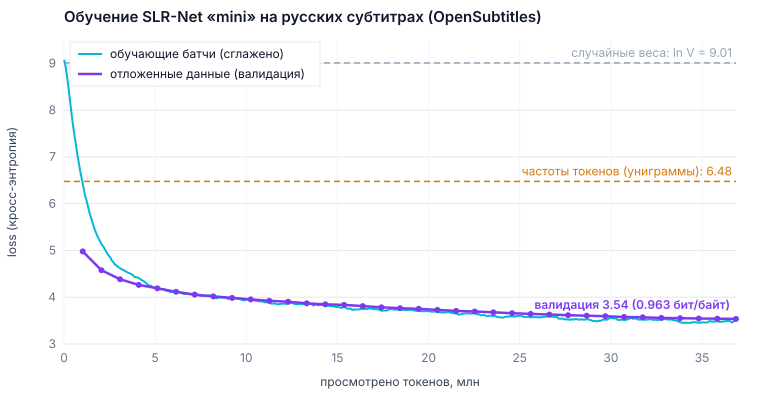

# Обучение SLR-Net на русских субтитрах фильмов

Отчёт о первом настоящем обучении языковой модели из этого репозитория (`slr_net_engine.py` +
`train_lm.py`) на большом открытом корпусе русской разговорной речи.

**Итог коротко:** модель `mini` (12.3 млн параметров, троичные веса) училась **6.1 часа** на обычном
процессоре (4 ядра, без видеокарты) и просмотрела **36.9 млн токенов** русских субтитров. На
отложенных текстах, которых модель не видела, ошибка снизилась с 9.06 (та же сеть со случайными
весами) до **3.534**: перплексия **34.3**, **0.962 бит на байт текста**. Частотная модель даёт
6.48, так что обученная модель намного лучше. Она пишет связные короткие реплики в стиле субтитров
и не копирует их из обучающих данных. Упакованные веса весят **8.9 МБ** и лежат в файле
[`slr_net_subtitles_ru_mini.npz`](slr_net_subtitles_ru_mini.npz).



## 1. Данные

| | |
|---|---|
| Источник | [OPUS](https://opus.nlpl.eu/) — OpenSubtitles v2018, одноязычная русская часть (`mono/ru.txt.gz`) |
| Ссылка на файл | https://object.pouta.csc.fi/OPUS-OpenSubtitles/v2018/mono/ru.txt.gz |
| Объём | 655 МБ в архиве → **2.34 ГБ** обычного текста UTF-8 (44.9 млн строк). Это укладывается в требование «от 300 МБ до 3 ГБ». |
| Что внутри | Реплики из субтитров к фильмам и сериалам, по одной на строку |
| Очистка | `train_lm.py prepare`: убираются таймкоды, номера субтитров, HTML-теги (`<i>`), ремарки в квадратных скобках, лишние пробелы |
| Токенизатор | SentencePiece Unigram, словарь 8192, перевод строки — отдельный токен `<n>`, цифры по одной, без `<unk>` (byte fallback). В среднем **5.30 байта текста на токен** |
| Токенов | 440.4 млн: 438.2 млн для обучения и 2.2 млн для проверки (последние 0.5% корпуса, то есть другие фильмы) |

Сами тексты в репозиторий **не добавлены**: они большие, и их легко скачать заново (команды ниже).
Папки `data/` и `runs/` и файлы `*.pt` исключены через `.gitignore`.

Корпус собран проектом OPUS из субтитров сайта [opensubtitles.org](http://www.opensubtitles.org/).
При использовании авторы просят ссылаться на статью: P. Lison and J. Tiedemann, 2016,
*OpenSubtitles2016: Extracting Large Parallel Corpora from Movie and TV Subtitles*, LREC 2016.

## 2. Модель и настройки обучения

Для обучения на CPU добавлен пресет **`mini`** — промежуточный между `tiny` (1.7 млн) и `small`
(26.5 млн). Размер подобран под бюджет «несколько часов на обычном процессоре». За 5–6 часов CPU
успевает ~37 млн токенов, а по правилу Chinchilla даже `mini` хотелось бы ~250 млн (~20 токенов на
параметр). Модель крупнее за то же время увидела бы ещё меньше текста на каждый параметр, и
недообученность была бы сильнее.

| | `mini` |
|---|---|
| Параметров | 12.3 млн, из них троичных {−1, 0, +1} — 8.3 млн, эмбеддинг 2.6 млн, память фактов 1.3 млн |
| Устройство | d_model 320; кодировщик из 6 слоёв (Mamba-2, каждый 3-й — локальное внимание с окном 128); ядро мышления из 2 слоёв, до 3 повторов с роутером; декодер из 3 слоёв; 5 голов внимания, 1 KV-голова |
| Упакованный размер | 8.9 МБ (троичные веса по 5 тритов в байт, остальное в float16); в float32 было бы 47 МБ |
| Контекст | 256 токенов ≈ 1.3 КБ текста ≈ 20–30 реплик |
| Батч | 16 × 256 = 4096 токенов на шаг |
| Шагов | 9000, всего 36.9 млн токенов (≈ 8% корпуса: каждый батч — новый текст) |
| Оптимизатор | AdamW (β = 0.9/0.95, weight decay 0.1), LR 1.5·10⁻³, прогрев 300 шагов, косинусный спад до 10%, клиппинг градиента 1.0 |
| Железо | 4 vCPU Intel Xeon 2.8 ГГц, без GPU; PyTorch 2.15 (CPU), `torch.compile` |
| Время | 6.1 часа (366 мин), 1600–2000 токенов/с |

Чтобы обучение на CPU шло быстрее, по пути исправлено и добавлено следующее:
- **Обнуление денормализованных чисел** (`torch.set_flush_denormal`). Сверхмалые числа в softmax
  обрабатывались процессором в десятки раз медленнее, теперь шаг на ~25% быстрее.
- **`--compile` на CPU** даёт ~1.7× ускорения. Раньше он считался полезным только на GPU.
- **Аллокатор jemalloc** (`LD_PRELOAD=…/libjemalloc.so.2`) немного ускоряет работу на Linux.
- **Остановка без потерь.** Чекпоинт записывается атомарно, при Ctrl+C сохраняется `last.pt`. При
  продолжении (`--resume`) случайные батчи выбираются заново и не повторяют начало обучения.
- **Журнал метрик** `metrics.jsonl` по каждой точке. По нему построен график.
- **Самодостаточные веса.** Токенизатор сохраняется внутри чекпоинта и `.npz`, поэтому для генерации
  исходные данные не нужны.
- **Загрузка упакованных весов** (`SLRNetLanguageModel.from_packed`): `.npz` можно сразу использовать
  для генерации и проверки.

## 3. Как шло обучение

Ошибка (кросс-энтропия, натуральный логарифм) на отложенных данных. Модель их не видела.
Для сравнения: у случайных весов ошибка 9.06, у частотной модели 6.48.

| Шаг | Просмотрено токенов | Ошибка на обучающих батчах* | Ошибка на отложенных | Перплексия | Бит/байт |
|---:|---:|---:|---:|---:|---:|
| 250 | 1.0 млн | 5.71 | **4.979** | 145.4 | 1.355 |
| 500 | 2.1 млн | 4.71 | **4.579** | 97.4 | 1.246 |
| 1 000 | 4.1 млн | 4.35 | **4.263** | 71.1 | 1.160 |
| 2 000 | 8.2 млн | 4.00 | **4.019** | 55.6 | 1.094 |
| 3 000 | 12.3 млн | 3.85 | **3.905** | 49.7 | 1.063 |
| 4 000 | 16.4 млн | 3.73 | **3.810** | 45.2 | 1.037 |
| 5 000 | 20.5 млн | 3.68 | **3.729** | 41.6 | 1.015 |
| 6 000 | 24.6 млн | 3.58 | **3.658** | 38.8 | 0.996 |
| 7 000 | 28.7 млн | 3.53 | **3.604** | 36.7 | 0.981 |
| 8 000 | 32.8 млн | 3.53 | **3.557** | 35.1 | 0.968 |
| 9 000 | 36.9 млн | 3.49 | **3.538** | 34.4 | 0.963 |

\* среднее по последним 250 шагам перед проверкой (батчи с обучающей части, каждый виден один раз)

- Ошибка на обучающих и на отложенных данных почти совпадает. Модель **обобщает, а не заучивает**,
  и это ожидаемо: каждый текст она видела не больше одного раза.
- Не было ни одного выброса или NaN, норма градиента держалась в пределах 0.5–1.2.
- Ошибка падала до самого конца: за последнюю 1000 шагов она снизилась ещё на 0.02, хотя шаг
  обучения к тому времени уменьшился в 10 раз. Значит, модели не хватило времени обучения, а не
  ёмкости. На GPU или при более долгом обучении на том же корпусе (438 млн токенов) она станет
  заметно лучше.

Полный журнал лежит в [`training/subs_mini/train.log`](training/subs_mini/train.log), все точки — в
[`training/subs_mini/metrics.jsonl`](training/subs_mini/metrics.jsonl).

## 4. Проверка: модель действительно обучилась

### 4.1. Сравнение с базовыми уровнями

`python train_lm.py eval` считает ошибку на 819 200 отложенных токенов (200 батчей по 16 × 256).
Сравниваются три модели: обученная, та же сеть со случайными весами и частотная (униграммная)
модель, которая всегда предсказывает токены по их частоте в 50 млн токенов корпуса. Результат лежит
в [`training/subs_mini/eval.json`](training/subs_mini/eval.json).

| Модель | Ошибка (loss) | Перплексия | Бит/байт |
|---|---:|---:|---:|
| Та же сеть со случайными весами | 9.060 | 8602 | 2.466 |
| Частоты токенов (униграммы) | 6.477 | 650 | 1.763 |
| Обученная модель, чекпоинт `best.pt` | **3.534** | **34.3** | **0.962** |
| Обученная модель, упакованный `slr_net_subtitles_ru_mini.npz` | **3.534** | **34.3** | **0.962** |

Перплексия 34 означает, что модель в среднем колеблется между ~34 вариантами следующего токена
из 8192 (частотная модель — между 650). **Бит на байт** не зависит от токенизатора, по нему можно
сравнивать разные модели. Сохранённый `.npz` даёт ту же ошибку, что и исходный чекпоинт (разница в пятом
знаке): упаковка весов качество не теряет.

Ещё одна простая проверка: модель знает **порядок** слов, а не только их частоты. На коротком
придуманном диалоге («— Привет! Как дела? — Хорошо, спасибо. А у тебя? …») ошибка равна 2.79. На тех
же словах в случайном порядке она 7.18. Частотной модели порядок безразличен. Эта проверка включена
в тесты (`tests/test_train_lm.py::test_shipped_subtitles_model_really_learned`) и выполняется над
файлом весов из репозитория.

### 4.2. Модель пользуется контекстом

Если модель действительно учитывает сказанное раньше, то чем больше текста она видит перед словом,
тем точнее его предсказывает. Ошибка по позиции токена в окне из 256 токенов (те же отложенные
данные, 50 батчей, [`context_use.json`](training/subs_mini/context_use.json)):

| Сколько токенов контекста видит модель | 0 | 1–7 | 8–31 | 32–63 | 64–127 | 128–255 |
|---|---:|---:|---:|---:|---:|---:|
| Ошибка | 4.84 | 3.79 | 3.61 | 3.55 | 3.55 | 3.52 |

Без контекста ошибка 4.84, с одной-двумя репликами контекста (≈ 30 токенов) — уже 3.6. Дальше
выигрыш небольшой. Модель использует ближайшие реплики, а длинную связь пока улавливает слабо.

### 4.3. Как менялась генерация

Запрос «Привет! Как дела?», модель на разных этапах обучения (из журнала обучения, без отбора):

| Шаг | Что написала модель |
|---|---|
| 0 | случайный набор токенов (ошибка 9.06) |
| 250 | Я тебе закрает. / — У меня нет. / — Хорошо. / — Это я знаю, но если в том, что это не нападишь. / — И ты должен знать, что это это будет. |
| 1 000 | Привет, Фрэнк. / Ты подвлечу свою жизнь. / Мы все вместе в моей комнате, потому что я должна уйти. / Я пойду. / Ты в порядке? |
| 3 000 | — Привет, пап. / Я здесь. / Ты знаешь, что я сказал? / Я не знаю. / Я просто с тобой. / Не бойся. |
| 6 000 | — Ты спокойся. / — Ладно. / Спасибо. / — Хорошо. / — А я знаю. / Если ты не понимаешь, что это значит — это восхождение. |
| 9 000 | Как дела? / Как дела, ребята? / Я слежу за баром. / Слежу, когда захочешь. / Ты что-нибудь затеял? / — Я не знаю. / — Да нет, нет! |

По примерам видно, что модель сначала выучила форму диалога (короткие реплики с тире), а затем слова
и грамматику: придуманных слов вроде «закрает» и «подвлечу» к концу стало заметно меньше.

### 4.4. Примеры финальной модели

Все запросы и seed были заданы заранее, вручную ничего не отбиралось. Все 16 результатов — в
[`training/subs_mini/samples.txt`](training/subs_mini/samples.txt).

```
Доктор, что с ним?
- С ним всё будет хорошо.
- Это мой брат?
- Да.
- Он выиграет!
- Я не могу позволить его убить, а он страдает.
```
```
Привет! Как дела?
- Привет, а это я.
У вас есть работа?
- Да.
Вот, вот.
- Что это значит?
- Ничего не изменилось.
```
```
Я тебя люблю.
- Нет, ты меня очень хорошо знаешь.
- Да, знаешь, я тебя знаю.
- Ты выглядишь очень счастливый.
- Я тоже.
- Мне тоже.
- Спасибо.
```
```
Где ты был всю ночь?
Ты был в этом доме.
- У вас есть имя?
- Да.
Вот оно.
Я видел только вещи, которые могли бы озаботься об этом.
```

Параметры: temperature 0.8, top-k 50, top-p 0.95, repetition penalty 1.1, 60 новых токенов. На CPU
генерация идёт со скоростью ~80 токенов/с.

### 4.5. Модель не копирует обучающие тексты

Все сгенерированные строки длиной от 30 символов искали дословно в 2.34 ГБ обучающего текста
(`grep -F`). Из 24 таких строк нашлась только одна — «Мне было приятно познакомиться.», обычная
фраза. Остальные 23 (96%) в субтитрах не встречаются. Короткие реплики вроде «Спасибо.» или «Что
случилось?», конечно, встречаются в субтитрах тысячи раз. Длинные модель составляет сама.

## 5. Честно об ограничениях

- **Это продолжатель текста, а не собеседник.** Модель пишет «следующие реплики фильма». На вопросы
  она не отвечает и фактов не знает: для этого нужен второй этап — пост-тренинг. Он сделан, результат —
  собеседник `slr_net_chat_ru_mini.npz`, подробности в [TRAINING_CHAT_RU.md](TRAINING_CHAT_RU.md).
- **Смысл держится 1–2 реплики.** Грамматика и стиль в основном правильные, но длинные фразы теряют
  логику, встречаются придуманные слова («озаботься», «фортепиона»). Для 12 млн параметров и 37 млн
  токенов это нормально (см. раздел 4.2).
- **Запрос влияет на ответ слабо.** Иногда ответ по теме («Доктор, что с ним?» → «С ним всё будет
  хорошо»), но при одинаковом seed продолжения для разных запросов нередко почти совпадают. Например,
  «— Нет, ты не можешь... — Это просто... — Ты должен...» получилось сразу для двух запросов (см.
  `samples.txt`). Модель в основном пишет «типичный диалог из фильма», а не отвечает на сказанное.
- **Стиль субтитров.** В тексте появляются имена персонажей («Фрэнк»), а иногда грубые слова и
  сцены насилия из фильмов.
- **Модель видела только ~8% корпуса.** Ошибка ещё падала, так что запас роста есть (см. раздел 3).
- **В браузере модель только отвечает.** В `slr_net_mobile_chat.html` есть режим «mini»: те же веса
  работают прямо в браузере (движок на JavaScript, совпадение с PyTorch проверяется тестом). Учится
  модель только через `train_lm.py`, а дообучение в браузере относится к режиму «Обычная» (поисковый
  прототип с собственной маленькой сетью).
- **Полный чекпоинт (149 МБ с состоянием оптимизатора) в git не добавлен.** GitHub не принимает
  файлы больше 100 МБ. Для генерации и проверки хватает `.npz`. Чтобы продолжить обучение, его
  нужно повторить по командам ниже или сохранить `runs/…/last.pt` у себя.

## 6. Как повторить

```bash
pip install -r requirements.txt

# 1) скачать и распаковать корпус (655 МБ → 2.34 ГБ)
mkdir -p data_raw && cd data_raw
curl -L -o ru.txt.gz https://object.pouta.csc.fi/OPUS-OpenSubtitles/v2018/mono/ru.txt.gz
gunzip -c ru.txt.gz > ru_subtitles.txt && cd ..

# 2) токенизатор + бинарный корпус (~11 минут)
python train_lm.py prepare --input data_raw/ru_subtitles.txt --out data/subs8k --vocab-size 8192

# 3) обучение (~6 часов на 4 ядрах CPU; на GPU — минуты, можно увеличить --max-steps)
LD_PRELOAD=/usr/lib/x86_64-linux-gnu/libjemalloc.so.2 \
python train_lm.py train --data data/subs8k --out runs/subs_mini --preset mini \
    --seq-len 256 --batch-size 16 --max-steps 9000 --warmup 300 \
    --eval-every 250 --eval-batches 20 --save-every 100 --log-every 20 --compile
#    прервалось? продолжить: та же команда + --resume runs/subs_mini/last.pt

# 4) проверка против случайной и частотной модели
python train_lm.py eval --ckpt runs/subs_mini/best.pt --data data/subs8k --batches 200

# 5) упаковка весов и генерация
python train_lm.py export --ckpt runs/subs_mini/best.pt --out slr_net_subtitles_ru_mini.npz
python train_lm.py sample --ckpt slr_net_subtitles_ru_mini.npz --prompt "Привет! Как дела?"
```

`LD_PRELOAD` можно не указывать: это только ускорение. jemalloc ставится через
`apt install libjemalloc2`.
